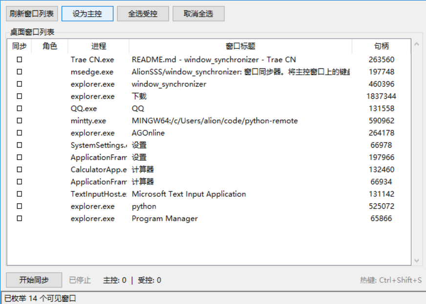

# 多窗口同步器

[](https://github.com/AlionSSS/window_synchronizer/releases)


[](LICENSE)

将主控窗口上的键盘、鼠标操作实时同步到多个受控窗口，实现"操作一个，全部跟随"。

适用于 Win32 GDI 渲染（基于 Windows 消息机制处理输入）的游戏或应用。无需额外组件，单文件 EXE 即可运行。



## 功能特性

- **窗口枚举** — 自动列出桌面可见窗口，显示进程名、窗口标题与句柄
- **主控 / 受控选择** — 指定一个主控窗口，勾选其余窗口作为受控，支持一键全选 / 取消全选
- **同步范围可选** — 「全部同步 / 仅键盘 / 仅鼠标」，运行中切换立即生效
- **键盘同步** — 按键与组合键同步到所有受控窗口
- **鼠标同步** — 左 / 右 / 中 / 侧键的单击、双击、滚轮（含横向滚轮）、拖拽与光标移动，支持跨窗口比例坐标映射
- **按键状态严格配对** — 按下与松开成对投递，丢失的松开会被自动补发，避免受控窗口停留在「按住」状态导致点击隔次失效
- **全局热键** — `Ctrl+Shift+S` 快速启停同步
- **窗口状态监控** — 窗口关闭时自动停止同步并从列表移除
- **单实例保护** — 阻止重复启动，避免同一操作被转发两次

## 快速开始

### 方式一：下载即用（推荐）

前往 [Releases](https://github.com/AlionSSS/window_synchronizer/releases) 下载最新的 `window_synchronizer_v*.zip`，解压后运行 `window_synchronizer.exe`。

### 方式二：从源码运行

需要 Windows 10/11 (64-bit)、Python 3.11+ 与 [uv](https://docs.astral.sh/uv/)。

```powershell
git clone https://github.com/AlionSSS/window_synchronizer.git
cd window_synchronizer

uv sync
uv run python main.py
```

## 使用说明

1. 启动程序，点击 **刷新窗口列表** 枚举桌面窗口
2. 选中一个窗口，点击 **设为主控**
3. 勾选需要同步的窗口（单击「同步」列，或双击该行任意位置；也可用 **全选受控** / **取消全选**）
4. 在 **同步范围** 中选择需要转发的输入类型（默认「全部同步」）
5. 点击 **开始同步** 或按 `Ctrl+Shift+S` 启动
6. 在主控窗口上操作，受控窗口自动跟随
7. 再次点击 **停止同步** 或按 `Ctrl+Shift+S` 结束

### 同步范围

**默认「全部同步」**，且**运行中切换立即生效，无需重启同步**：

| 选项 | 键盘同步 | 鼠标同步 | 适用场景 |
| --- | :---: | :---: | --- |
| **全部同步**（默认） | ✅ | ✅ | 需要同时转发键盘与鼠标操作 |
| **仅键盘** | ✅ | ❌ | 只需要同步按键（如挂机脚本按键） |
| **仅鼠标** | ❌ | ✅ | 只需要同步点击 / 移动 |

> 未被选中的输入类型只会「不转发」，主控窗口自身的键盘 / 鼠标输入不受影响。

## 注意事项

1. **仅前台生效**：只有当前激活（前台）窗口为主控窗口时，键盘和鼠标事件才会被转发；在受控窗口或其他应用上的操作不会触发同步。
2. **权限需一致**：建议本程序与目标游戏以相同权限运行；若游戏以管理员身份运行，本程序也需以管理员身份启动，否则转发的消息可能被系统拒绝。
3. **坐标精度**：程序已声明 DPI 感知（Per-Monitor V2），无需把系统缩放改为 100%；但若主控与受控窗口自身的边框 / 标题栏宽度不同，边缘位置仍可能有几像素偏差。
4. **反作弊限制**：部分带反作弊机制的游戏可能拦截模拟输入，本工具仅适用于允许此类操作的游戏。

## 常见问题

**Q：开始同步后受控窗口没有任何反应？**

- 确认已设置主控窗口，且至少勾选了一个受控窗口；
- 确认操作时主控窗口处于前台激活状态；
- 确认「同步范围」包含你正在使用的输入类型；
- 确认程序与游戏权限一致。

**Q：现象是「点击一次生效、下一次无效」？**

- 确认没有同时运行多个本程序实例（多开会导致同一操作被转发两次）；
- 程序已在停止同步、切换同步范围时自动补齐残留的按下状态；若仍复现，请先停止再重新开始同步并反馈。

**Q：`Ctrl+Shift+S` 热键无效？**

该组合键可能已被其它软件占用，程序会在状态栏提示注册失败，此时请改用界面按钮启停。

**Q：主控窗口关闭后会怎样？**

程序会自动检测并停止同步，同时从列表中移除已关闭的窗口。

**Q：不同分辨率的窗口能同步吗？**

鼠标坐标按窗口客户区做比例映射，分辨率不同也能点中相对位置；但界面布局比例差异过大的游戏可能出现偏差。

## 项目结构

```text
window_synchronizer/
├── main.py               # GUI 主界面 (tkinter)
├── sync_engine.py        # 同步引擎 (Win32 钩子 + 消息转发)
├── theme.py              # 主题配置 (莫兰迪蓝色调)
├── resources/
│   └── icon.ico          # 程序图标
├── pyproject.toml        # 项目配置 (uv)
├── uv.lock               # 依赖锁定文件
├── LICENSE               # MIT 许可证
└── README.md
```

## 技术架构

```text
┌──────────────────────────────────────────┐
│                main.py                   │
│             (tkinter GUI)                │
│   窗口列表 │ 同步范围 │ 控制面板 │ 状态栏  │
└────────────────────┬─────────────────────┘
                     │ 通知队列 (Queue)
┌────────────────────▼─────────────────────┐
│              sync_engine.py              │
│                                          │
│  WH_KEYBOARD_LL ─┐                       │
│                  ├─► 同步范围闸门         │
│  WH_MOUSE_LL ────┘   (BOTH/KEYBOARD/     │
│                       MOUSE)             │
│  RegisterHotKey ──► Ctrl+Shift+S         │
│                                          │
│  PostMessageW ──► 受控窗口                │
└──────────────────────────────────────────┘
```

- **键盘钩子** (`WH_KEYBOARD_LL`)：捕获主控窗口按键 → `PostMessageW` 转发 `WM_KEYDOWN/UP`
- **鼠标钩子** (`WH_MOUSE_LL`)：捕获点击 / 移动 / 滚轮 → `ScreenToClient` 坐标转换 → `PostMessageW` 转发；移动事件按 8ms 节流
- **按键配对**：按窗口记录「已投递按下、未投递松开」的按键掩码；松开消息不受前台 / 矩形过滤，并由 `GetAsyncKeyState` 定期核对物理状态补发丢失的松开
- **同步范围** (`SyncMode`)：在钩子回调入口按所选范围放行，未选中的输入类型不参与转发
- **热键**：`RegisterHotKey` + 窗口过程子类化 → `Ctrl+Shift+S` 启停
- **线程模型**：钩子运行在独立后台线程（`MsgWaitForMultipleObjects` 定时唤醒的消息泵）；回调只读不可变快照，不持锁、不阻塞；通知通过 `Queue` 传回主线程 UI
- **单实例**：命名互斥体 `Local\WindowSynchronizer.SingleInstance`

## 开发

```powershell
uv sync                    # 安装依赖
uv run python main.py      # 运行程序
uvx ruff check .           # 代码检查
uvx ruff format .          # 代码格式化
```

### 打包为 EXE

```powershell
# 安装 PyInstaller（作为开发依赖）
uv add --dev pyinstaller

# 打包
uv run pyinstaller -D -w -i resources\icon.ico --add-data "resources\icon.ico:resources" -n window_synchronizer main.py
```

| 参数 | 说明 |
| --- | --- |
| `-D` | 生成目录形式（启动更快） |
| `-w` | 无控制台窗口 |
| `-i` | 指定图标 |
| `--add-data` | 打包资源文件，格式为 `源路径:目标目录` |
| `-n` | 输出名称 |

## 免责声明

本工具仅用于合法的多窗口操作同步与技术学习研究。请勿将其用于违反任何游戏服务条款或相关法律法规的场景，使用者需自行承担因使用本工具产生的一切后果。

## 许可证

本项目基于 [MIT License](LICENSE) 开源。
